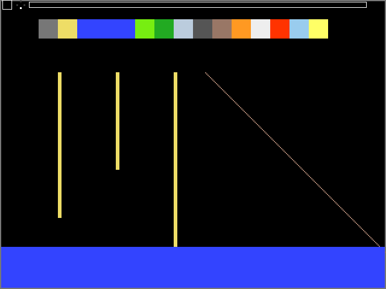

# TILT-SAND: a falling-sand physics toy in pure FPGA hardware

A real-time **falling-sand cellular automaton** that runs entirely in digital logic
on a Terasic **DE10-Lite** (Intel MAX 10 `10M50DAF484C7G`). There's no CPU and no
soft-core, and no software runs anywhere on the board. A 320×240 grid of sand,
water and walls is simulated in hardware at 100 MHz, drawn to a VGA monitor at
640×480@60 Hz, and **you tilt the board to change gravity**: the onboard ADXL345
accelerometer steers which way everything falls.

> 🎥 **Demo video:** _coming soon_
<!-- Replace the line above with the video link or an embedded GIF/MP4, e.g.
     https://github.com/<user>/<repo>/assets/... (drag-and-drop the file into a
     GitHub issue/README editor to get an upload URL). -->



*Above: the first VGA frame as produced by the full-chip Questa simulation (`tb_top`),
checked pixel-exact against a Python golden model. The top bar is the on-screen HUD:
selected-material swatch, gravity D-pad, and particle-count bar.*

---

## How this was built: an AI-driven hardware experiment

The goal of this project was to find out **how far AI coding agents can get on
real FPGA hardware design** if you just point them at a hard target and let
them run. Essentially all of the RTL, testbenches, Python golden models, scripts
and documentation in this repo were written by AI agents. I (Justin Dubreuil)
was the director and the hardware tester:

- picked the project and the target board, and set the ground rules (spec first,
  golden model, self-checking testbench, clean timing closure before calling
  anything done; see [`AGENTS.md`](AGENTS.md) and [`docs/CONVENTIONS.md`](docs/CONVENTIONS.md));
- flashed the builds onto the physical DE10-Lite and reported what looked wrong
  on the monitor (water forming a hump instead of leveling, sand stacking into
  towers, water "teleporting" as a checkerboard gas, ...);
- made the design calls when the agents proposed alternatives (e.g. velocity-tagged
  water vs. a lattice-gas rewrite, see [`docs/PLAN_water_momentum.md`](docs/PLAN_water_momentum.md)).

The agent configuration and prompts that drove the work are checked in under
[`.github/`](.github) and [`AGENTS.md`](AGENTS.md). The full engineering log, with
every milestone, timing failure and fix, and every physics rework triggered by
hardware testing, is in [`docs/STATUS.md`](docs/STATUS.md). The git history
shows the project's progression.

The originating brainstorm ("twelve insane-but-plausible DE10-Lite projects")
is kept in [`PROJECT_IDEAS.md`](PROJECT_IDEAS.md). This project is idea #10.
Parts of the platform layer (clocking, reset, VGA timing, HEX, UART) were carried
over from an earlier AI-built project on the same board, a hardware raycaster.

---

## Features

- **320×240 cell grid, 4 bits/cell**, double-buffered in on-chip M9K block RAM.
  The grid *is* the framebuffer, so no SDRAM is needed.
- **Margolus 2×2 block cellular automaton.** Every rule is a permutation of the four
  cells in a block, so **mass conservation is structural**: particles can never be
  created or destroyed by the engine. Simulation asserts check it every frame.
- **8 physics passes per displayed frame**, run in place on the back buffer, so
  material flows at a natural speed.
- **Materials:**
  - **Sand** is granular. It falls, slides diagonally, and piles into pyramids
    at a natural ~45° angle of repose.
  - **Water** is a fluid with **momentum**. Water cells carry a horizontal velocity
    tag (`WATER` / `WATER_R` / `WATER_L`), so poured water sloshes, overshoots,
    makes decaying waves, and rises in a U-tube, all within the same 4-bit
    cell. Sand sinks through water by density.
  - **Wall** is immovable.
  - IDs 6–15 have palette colours reserved for future reactive materials (acid,
    plant, steam, lava, ...). For now they behave as generic granular solids.
- **Tilt-controlled gravity.** An SPI master reads the ADXL345 at ~100 Hz. The
  dominant tilt axis (with a dead-zone) selects DOWN / UP / LEFT / RIGHT gravity.
  Gravity is implemented by rotating each 2×2 block into a canonical frame,
  applying the rule, and rotating back.
- **Interactive brush.** Pick a material on the switches, hold a button to pour it
  in, and flip a switch to clear the grid.
- **On-screen HUD** plus a live particle count on the 7-segment displays.
- Retained **UART peek/poke** debug channel.

## Controls (DE10-Lite)

| Control | Function |
|---|---|
| `KEY[0]` | Reset |
| `KEY[1]` (hold) | Pour the selected material (3×3 emitter at top-centre) |
| `SW[5:2]` | Material select (`2` = sand, `3` = water, `1` = wall, `0` = eraser/empty) |
| `SW[8]` | `0` = gravity from board tilt (accelerometer), `1` = manual gravity |
| `SW[1:0]` | Manual gravity when `SW[8]=1`: `0` down, `1` up, `2` left, `3` right |
| `SW[9]` | Clear the grid (redraws the wall border) |
| `HEX3..HEX0` | Live particle count (non-empty cells, hex) |
| `HEX4` | Selected material ID |
| `HEX5` | Current gravity direction |
| `LEDR[9]` / `LEDR[8]` | Engine busy / brush busy (`LEDR[7:0]` echo the switches) |
| VGA | 640×480@60 Hz, each cell drawn as a 2×2 pixel block |

On power-up the grid loads a test scene (sand columns, a material swatch strip, a
diagonal line and a water pool) baked into the FPGA configuration image, so the
physics starts immediately.

## Architecture

```
               MAX10_CLK1_50
                     │
                 pll_sys ──► clk_100 (physics / control)   clk_25 (VGA pixel clock)
                     │
  ADXL345 ─SPI─► adxl345_spi ─► gravity_ctrl ─┐
  KEY/SW ──────► debounce / brush ──────────┐ │
                                            ▼ ▼
               ┌──────────── clk_100 ──────────────┐        ┌──────── clk_25 ───────────┐
               │  frame sequencer                  │        │                           │
               │   ├─ particle_count (read front)  │        │ vga_timing ─► grid_scanout│
               │   ├─ margolus_engine × 8 passes   │ port A │      │            │ port B │
               │   │    └─ block_rule (3-stage)    ├───────►│  grid_mem (2 × 320×240×4) │
               │   └─ brush (write back)           │        │      │                    │
               └───────────────────────────────────┘        │  palette ─► hud_overlay ─►│─► VGA
                     frame_done ──(2-FF CDC, swap at vsync)─►│                           │
                                                            └───────────────────────────┘
```

- **`grid_mem`**: two true-dual-port BRAM banks. The engine reads the front bank
  and writes the back bank on port A (clk_100). The scanout reads the front bank
  on port B (clk_25). The front/back swap happens at vsync, so there's no tearing.
  The only signal that crosses clock domains is the single swap bit (2-FF
  synchronizer). The grid data itself crosses through the dual-clock BRAM.
- **`margolus_engine`**: FSM that walks the grid in 2×2 blocks, alternating
  the block lattice offset every pass, and feeds each block through a
  **3-stage pipelined rule** (`block_rule_fall` → `block_rule_flow` →
  `block_rule_settle`). The pipeline split was needed to close timing at
  100 MHz on the slowest speed grade.
- **`block_rule`**: the physics. Each phase is a swap, so conservation holds by
  construction. The phases are: density fall, granular diagonal slide, water
  rise, momentum advection, cohesive repack, and damping. A 16-bit LFSR breaks
  symmetric ties.

Each non-trivial module has a spec in [`docs/SPEC_*.md`](docs), written before its RTL.
[`docs/SPEC_sand_overview.md`](docs/SPEC_sand_overview.md) is the top-level design document.

## Verification

Every module follows the same contract: **spec → Python golden model →
self-checking SystemVerilog testbench → Questa script → Quartus fit + timing**.

| Testbench | What it proves |
|---|---|
| `tb_block_rule` | **Exhaustive**: all 20,736 block/gravity/random combinations match the Python golden model bit-exactly and conserve mass |
| `tb_margolus_engine` | Multi-frame, multi-pass grid stepping. Mass is conserved every frame, walls stay put, and pyramids form |
| `tb_water_momentum` | Grouped mass conservation every frame, and slosh amplitude decays over time (waves die out) |
| `tb_top` | Full chip (PLL → engine → BRAM → palette → VGA): every visible pixel matches `palette[grid[y/2][x/2]]` (409,921 pixels) |
| `tb_grid_mem`, `tb_grid_scanout`, `tb_brush`, `tb_particle_count`, `tb_hud_overlay`, `tb_lfsr` | Memory/swap/CDC behaviour, pixel addressing, emitter, counter, HUD, PRNG period |
| `tb_adxl345_spi`, `tb_gravity_ctrl` | SPI mode-3 transactions against a mock sensor; tilt → gravity with dead-zone and override |
| `tb_vga_timing`, `tb_pll_sys`, `tb_reset_sync`, `tb_debounce`, `tb_hex_driver`, `tb_uart_*` | Platform layer |

### Resource usage and timing (Quartus Prime Lite 23.1std.1)

| Resource | Used |
|---|---|
| Logic elements | 1,825 / 49,760 (4%) |
| Registers | 734 |
| Block memory bits | 614,784 / 1,677,312 (37%) |
| DSP multipliers | 0 |
| PLLs | 1 / 4 |
| Timing | All corners closed. Worst setup slack +0.192 ns at 100 MHz (C7 speed grade) |

## Repository layout

```
rtl/
  top.sv           top level (pins, sequencer, clock-domain glue)
  platform/        PLL, reset, VGA timing, palette, HEX, debounce, UART, ADXL345 SPI, gravity
  sand/            grid_mem, margolus_engine, block_rule*, brush, particle_count, HUD, LFSR
sim/
  tb/              one self-checking testbench per module (tb_<module>.sv)
  golden/          Python reference models + generated vectors / memory images
  scripts/         Questa do-scripts (do_<module>.do)
constraints/       SDC timing constraints
docs/              specs, conventions, engineering log (STATUS.md)
sand_falling.qpf/.qsf  Quartus project (device, pins, file list)
```

## Building and running

**Requirements:** Quartus Prime Lite 23.1std (MAX 10 device support), Questa Intel
FPGA Starter Edition (free license), Python 3 with Pillow (only to regenerate
golden data/images), and a DE10-Lite with a VGA monitor.

**Synthesize and program** (from the repo root):

```powershell
quartus_sh --flow compile sand_falling
quartus_pgm -m jtag -o "p;sand_falling.sof"
```

Or open `sand_falling.qpf` in Quartus, compile, and program with the Programmer.

**Run a testbench** (from the repo root):

```powershell
vsim -c -do sim/scripts/do_block_rule.do
vsim -c -do sim/scripts/do_top.do
```

**Regenerate golden data** (optional, the outputs are committed):

```powershell
python sim/golden/sand_materials.py   # palette
python sim/golden/sand_grid.py        # power-on grid images + expected frame
python sim/golden/block_rule.py       # exhaustive rule vectors
```

## Known limitations / future work

- Thin or airborne water breaks into a droplet-like spray during violent sloshing,
  and a calm pool keeps a faint surface shimmer. Both come from encoding momentum
  in 2×2 Margolus blocks (details in `docs/STATUS.md`).
- Gravity is 4-way (dominant tilt axis). An 8-way or probabilistic blend is planned.
- Reactive materials (fire, acid, plant, steam, lava, ...) are on the roadmap
  (milestone M7) but not implemented yet.

## License

[MIT](LICENSE) © 2026 Justin Dubreuil
